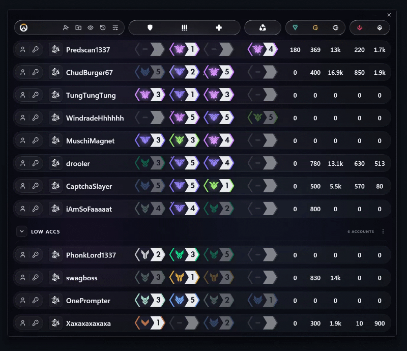

<p align="center">
<a href="https://apps.microsoft.com/detail/9N35JP1XQHVS?referrer=appbadge&mode=direct"></a>
<br />
<a href="https://github.com/MerkDesigns/RankDB/releases/latest/download/RankDB_installer.exe"> </a>
</p>

# RankDB

RankDB is a simple desktop app for tracking multiple Overwatch accounts in one place.

It helps you keep ranks, notes, currencies, login details, and account status organized without needing a spreadsheet.



## Features

- Easy access copy Battletag button next to account name
- Credential manager with autodelete from copy-paste. (Password and E-Mail, kept out of clipboard history, optionally protected with a master password)
- Track Tank, Damage, Support, and 6v6 ranks
- Mark ranks as predicted (P) and track your placement match progress
- Reset Rank button on actual full on rank reset. (resets all ranks for all accounts and keeps previous ranks, viewable from the toolbar; the latest reset can be undone)
- Track Mythic Prisms, Overwatch Coins, Overwatch Credits, Competitive Points, and Legacy Points
- Expandable and collapsable Account Groups (For the actual degenerates with 1million accounts)
- Drag and drop accounts to reorder them or move them into groups
- Sorting accounts by rank or currency regardless of groups (click on the role or currency icons to sort)
- Move banned accounts and accounts that need SMS verification into their own sections
- Export and import all your data in password-protected encrypted backups
- Check for app updates from inside RankDB (checks on start, installs when you choose)
- Privacy Mode (incase you stream the application and dont want everyone to see the Account names)
- Game Dodge counter, log your dodged games to see how long the next comp-ban will be after dodging
- Discord Rich Presence (Discord activity shows you using RankDB when its open)
- Accent colour, UI scale and column toggles

## Windows Warning

RankDB is not code-signed right now.

Because of that, Windows may show a warning like `Unknown Publisher` or `Windows protected your PC` when opening the installer.

This is expected for now. A code-signing certificate costs money, and the project does not currently have one.

## Privacy

RankDB is built to keep your data local.

- Your account data stays on your own machine
- Backup exports are password-protected
- E-Mails and passwords can be encrypted with a master password (Settings → Data)

As always, keep your PC secure and use a strong device password if you store account details locally.

## Install

Get RankDB from the [Microsoft Store](https://apps.microsoft.com/detail/9N35JP1XQHVS): the Store installs and updates it for you.

Or click the download button above, or go to the repository `Releases` section and download `RankDB_installer.exe`.
After the first install, future updates can be checked from inside RankDB. Updating from RankDB 0.3 keeps your accounts: they are moved over on the first start.

## Building from source

Requires [Node.js](https://nodejs.org/) 24, [Rust](https://rustup.rs/) and the
[Tauri prerequisites](https://tauri.app/start/prerequisites/) for Windows.

```bash
npm install
```

```bash
npm run app:dev
```

`npm run check` typechecks, builds and runs `cargo check`. Interface text lives in
[`src/text/strings.json`](src/text/strings.json) ([editing guide](docs/EDITING-TEXT.md)).

Built with Tauri 2, React 19, TypeScript and SQLite.

## License

This project is licensed under the GNU General Public License v3.0.

See `LICENSE` for details.
